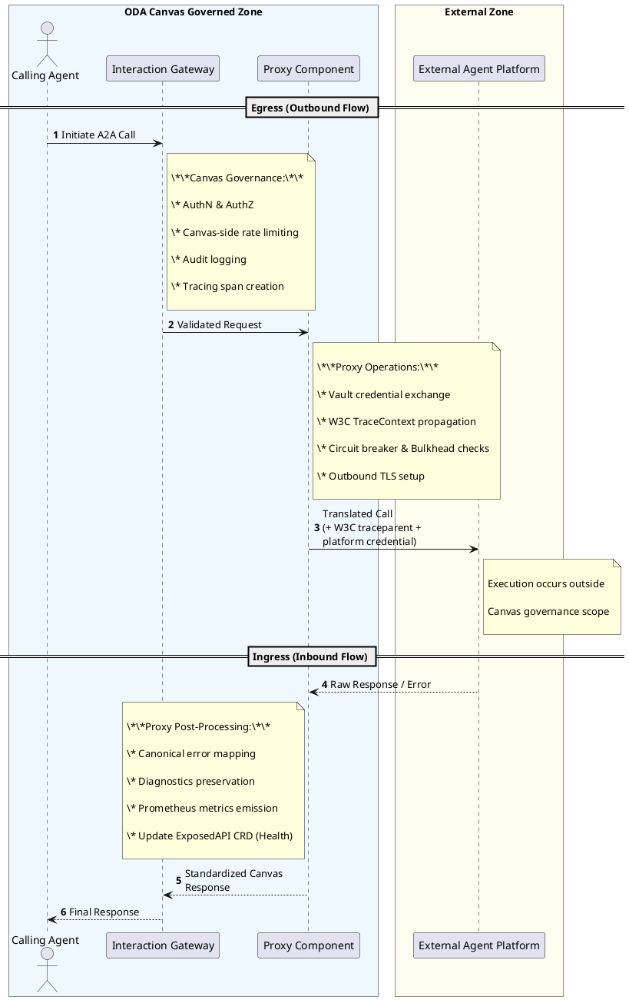
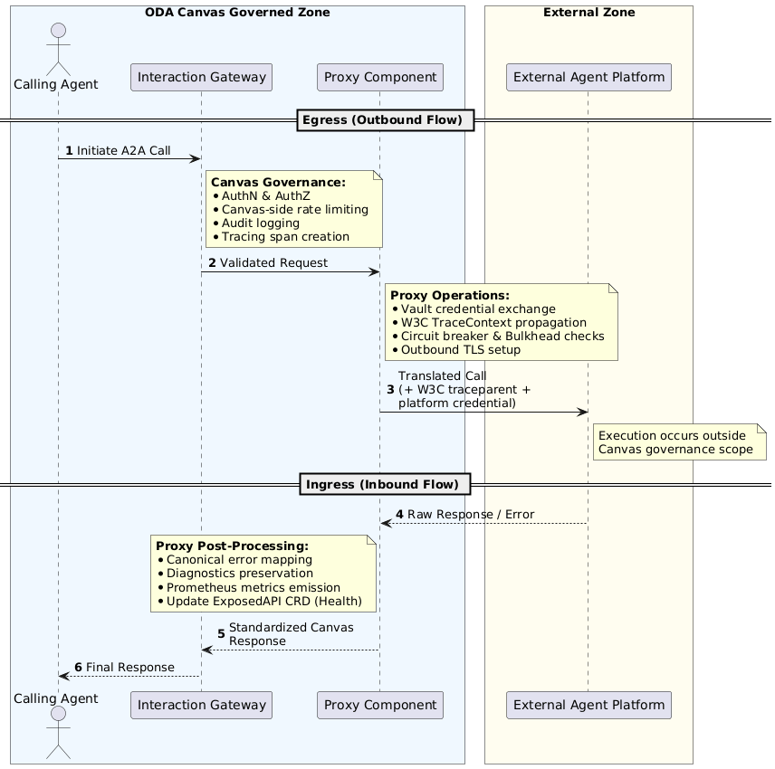

AI-Native ODA Canvas | Architecture Decision Record

**ADR-008 — Proxy Pattern for External Agent and Tool Integration**

| **Field** | **Value** |
| --- | --- |
| ADR Number | ADR-008 |
| Date | 2026-03-26 |
| Status | Proposed |
| Supersedes | ADR-008 stub (2026-03-17) |
| Author | AI-Native Canvas Architecture Working Group |
| Related ADRs | ADR-001, ADR-002, ADR-003, ADR-004, ADR-005, ADR-007, ADR-009 |

## Status

|  |
| --- |
| **PROPOSED** |

## Context

Enterprise AI environments include agents and tools that cannot or should not be redeployed inside Canvas — externally hosted runtimes (AWS Bedrock Agents, Azure AI Foundry, LangGraph Cloud), SaaS agent services, out-of-cluster MCP servers, legacy OSS/BSS systems exposing REST/SOAP/gRPC, external data platforms (Databricks, Snowflake), and Cross-Canvas agents in federation scenarios.

Canvas must integrate these entities while maintaining its full architectural contracts: governance, identity, observability, standardised interaction interfaces (ADR-002), and control-plane lifecycle visibility (ADR-001). Without a standardised integration mechanism, external capabilities would be invisible to the Canvas control plane, discovery plane, and governance framework — bypassing Keycloak identity, escaping Interaction Gateway mediation, and creating shadow integrations that undermine ADR-001 through ADR-007.

## Proxy Pattern Taxonomy

Three structurally distinct deployment patterns can each be described as a 'proxy.' These are not interchangeable — they differ in control-plane representation, governance coverage, and operational complexity.

## Pattern A — Facade Component (Stub Proxy) ← PRIMARY PATTERN

A thin ODA Component is deployed inside Canvas. It exposes standardised interaction interfaces (A2A, MCP, OpenAPI) per ADR-002 but contains no agent execution logic. All requests are forwarded to an external agent platform. The external platform retains responsibility for agent reasoning, tool invocation, and execution.

* Control-plane representation exists: the proxy is an ODA Component with CRD presence.
* Interaction interfaces are standardised and discoverable via Resource Inventory (ADR-003).
* Canvas governance covers the proxy boundary; external platform governs beyond it.
* Requires identity bridging, error translation, timeout management, and observability handoff at the proxy layer.

The table below lists the Architectural Concerns to be considered implementing the Proxy Component:

| **Architectural Concern** | **Severity** |
| --- | --- |
| Identity bridging mechanism | Critical |
| Error / timeout / resilience contract | High |
| Observability Architectural Concern at boundary | High |
| Agent card / Skills strategy | High |
| Proxy lifecycle operator | High |
| Governance scope boundary | Medium |
| Admission control missing | Medium |

|  |
| --- |
| **DECISION**  Pattern B is the primary and only permitted external integration pattern for ADR-008. |

## Pattern B — Sidecar Adapter Proxy

Agent logic runs inside Canvas as a native ODA Component. A sidecar container translates between the agent's native internal protocol and the Canvas interaction interface model (ADR-002).

* Agent execution is fully Canvas-native; full lifecycle management via Canvas operator model.
* Full observability — all spans within the cluster's OTel collector reach.
* The sidecar becomes a per-framework protocol translation layer to maintain.
* This is a native deployment implementation detail, NOT a proxy pattern in the sense of ADR-008.

*Assessment: Pattern B does not address integration with genuinely external execution platforms. Out of scope for ADR-008.*

## Pattern C — Gateway-Registered Virtual Agent

No ODA Component exists. The external agent is registered directly at the Interaction Gateway level as a named routing entry. No Kubernetes CRD, no operator lifecycle management, no Resource Inventory visibility.

* Operationally the simplest path — but violates ADR-001: no ODA Component as control-plane anchor.
* Invisible to Resource Inventory — agent cannot be discovered via standard platform discovery.
* Governance coverage limited to gateway routing policy only.

|  |
| --- |
| **PATTERN C: EXPLICITLY PROHIBITED**  Pattern C is architecturally inconsistent with ADR-001 and ADR-003.  It creates unmanaged, undiscoverable agents outside the platform lifecycle model.  May only be reconsidered alongside a future VirtualAgent CRD proposal. |

## Proxy Archetype Taxonomy

Within Pattern A, three implementation archetypes are defined to guide implementation selection, resource sizing, and operational expectations. Component developers must declare the archetype via annotation: canvas.oda.org/proxy-archetype: identity | protocol | semantic.

| **Archetype** | **Use case** | **Canvas interface** | **External interface** | **Proxy responsibility** | **Resource profile** |
| --- | --- | --- | --- | --- | --- |
| Identity proxy | External service speaks Canvas-compatible protocol but uses different auth | Same as external (e.g., A2A → A2A) | Same protocol, different auth | Keycloak token → external credential exchange; health check forwarding | <64MB RAM, <0.1 CPU |
| Protocol proxy | External service uses a different protocol than Canvas consumers expect | Canvas-standard (e.g., MCP) | Different protocol (gRPC, SOAP, proprietary REST) | Protocol translation; request/response mapping; error normalisation | 128–256MB RAM, 0.1–0.25 CPU |
| Semantic proxy | External service has a fundamentally different data model or interaction pattern | Canvas-standard with domain-specific Agent Card / Tool manifest | Arbitrary | Full semantic mapping; Agent Card generation; state management; capability negotiation | 256MB–1GB RAM, 0.25–0.5 CPU |

Reference implementation targets: Identity proxy <200 lines, Protocol proxy <500 lines, Semantic proxy <1500 lines (Go or Python).

## Decision

The architecture adopts the Facade Component (Pattern A) as the canonical proxy pattern for integrating external agents, tools, and services into Canvas. Under this pattern:

* External runtime entities are represented within Canvas through lightweight proxy ODA Components.
* Proxy components expose standardised interaction interfaces per ADR-002.
* Actual execution logic resides outside the Canvas environment.
* The proxy component is the governance boundary: Canvas governs to and including the proxy; the external platform governs beyond it.
* The proxy archetype must be declared at deployment time via the canvas.oda.org/proxy-archetype annotation.
* Pattern B is a valid native deployment implementation detail, out of scope for ADR-008.
* Pattern C is explicitly prohibited.

## Architectural Concern 1 — Identity Bridging Mechanism

### Background

A proxy component must authenticate to external agent platforms that each have their own identity models (AWS IAM, Azure Entra ID, OAuth2, proprietary API keys). In a CSP ecosystem, Canvas is deployed across heterogeneous Kubernetes clusters — EKS, AKS, OpenShift, on-premises, and edge — and a single proxy component may need to reach external platforms hosted across different providers.

Platform-native workload identity mechanisms (IRSA for AWS, Azure Workload Identity for Azure) only function on their respective managed Kubernetes services. They cannot be used on vanilla Kubernetes clusters, on-premises deployments, or in any multi-cloud topology. Without a provider-agnostic mechanism, the only cross-cluster fallback would be static secrets — long-lived, scope-wide, and high blast-radius.

The Canvas reference implementation already includes a Secrets Management Operator backed by HashiCorp Vault, configured via CanvasVault/setup\_CanvasVault.sh to trust the cluster's ServiceAccount issuer using Vault's Kubernetes Auth method. This is an existing, operated dependency — not a new platform requirement. It covers any Kubernetes distribution, making it the natural provider-agnostic identity bridge for the proxy pattern.

### Alternatives Considered

***Option 1 — Vault-brokered credential federation ← PRIMARY***

The proxy component's Kubernetes ServiceAccount is registered in Vault under the Kubernetes Auth method. When the proxy pod starts, it authenticates to Vault by presenting its projected ServiceAccount token. Vault validates the token against the cluster's Kubernetes TokenReview API — a standard K8s API call that works identically on EKS, AKS, GKE, OpenShift, k3s, and bare-metal clusters. Vault then issues a short-lived Vault token scoped to a policy covering only the secrets or dynamic credentials that specific proxy component needs.

For external platforms with dynamic secrets engine support, Vault issues platform credentials on demand:

* AWS targets: Vault AWS Secrets Engine calls sts:AssumeRole on behalf of the proxy and returns short-lived AccessKeyId / SecretAccessKey / SessionToken.
* Azure targets: Vault Azure Secrets Engine generates a short-lived service principal credential.
* Other platforms: Vault KV Secrets Engine stores the platform credential with a TTL-based lease; Vault handles rotation and notifies the Secrets Operator for re-sync.

For Canvas deployments spanning multiple clusters, each cluster registers its own Kubernetes Auth mount in Vault — Vault becomes the single identity authority across the multi-cluster fleet.

Advantages: provider-agnostic; works on any Kubernetes distribution; leverages existing Canvas Vault operator; dynamic credentials means no long-lived secrets in the cluster; each proxy maps to its own Vault role; unified audit trail across all clusters and external platforms.

Disadvantages: Vault availability becomes a dependency for credential acquisition — a Vault outage blocks proxy components. Vault must be operated with HA configuration in production Canvas deployments.

***Option 2 — Vault-managed static secrets via Secrets Operator — fallback***

For platforms that do not support dynamic credential issuance, a static credential is stored in Vault KV with an operator-defined TTL. Vault notifies the Secrets Operator on lease expiry; the operator re-syncs the Kubernetes Secret automatically. Vault provides audit logs, lease expiry, and revocation. Fallback only — must be declared in complianceMetadata.

***Option 3 — Platform-native workload identity federation (IRSA / Azure Workload Identity)***

IRSA (AWS) and Azure Workload Identity (Azure) use the cluster's OIDC issuer to exchange Kubernetes ServiceAccount tokens for short-lived platform credentials. Applicable clusters: EKS (IRSA) and AKS with Azure WI webhook only. Not applicable on vanilla Kubernetes, OpenShift, on-premises, or cross-cloud Canvas deployments. Remains valid as a single-cloud deployment simplification, not the architectural default.

***Option 4 — SPIFFE/SPIRE with Vault as upstream CA — deferred future evolution***

SPIRE attests workloads cryptographically and issues SVIDs independent of the Kubernetes TokenReview API. Vault federates trust against the SPIRE OIDC Discovery endpoint and issues dynamic platform credentials. Removes any dependency on the Kubernetes API server for identity attestation — optimal for edge clusters and air-gapped Canvas deployments. Deferred to a dedicated platform infrastructure ADR pending operational assessment.

### Decision

|  |
| --- |
| **DECISION**  Vault-brokered credential federation is adopted as the primary identity bridging  mechanism (Option 1), leveraging the existing Canvas Secrets Management Operator.  How it works: proxy pod presents its ServiceAccount token to Vault Kubernetes Auth.  Vault validates via TokenReview API, issues a scoped Vault token, then issues  short-lived platform credentials via the appropriate Vault secrets engine.  This works on any Kubernetes cluster — cloud, on-premises, or multi-cluster fleet.  Each proxy component must be mapped to its own Vault role, scoped to its namespace  and ServiceAccount name. Shared Vault roles across proxy components are not permitted.  Platform-native federation (IRSA / Azure Workload Identity) is permitted as a  single-cloud deployment simplification. Not the architectural default for CSP deployments.  Vault-managed static secrets (Option 2) are permitted only as a fallback for  platforms without dynamic secrets engine support. Must be declared in complianceMetadata.  SPIFFE/SPIRE with Vault as upstream CA (Option 4) is deferred to a future platform  infrastructure ADR as the recommended evolution path for edge and air-Architectural gapped deployments.  The mechanism in use must be declared in the proxy component's identityConfig. |

## Architectural Concern 2 — Error, Timeout, and Resilience Contract

### Background

The Canvas interaction contract is the interface agreement defined in ADR-002: any component exposing or consuming an interaction interface must conform to the request/response structure, error signalling, and metadata format of its declared apiType. A caller invoking an A2A interface expects an A2A-compliant response — not a raw AWS SDK exception, a gRPC status code, or an HTTP 500 with a platform-specific payload.

A proxy component accepting a Canvas A2A or MCP call must return a response conforming to this contract regardless of what the external platform returns. Without an explicit error translation contract, the Interaction Gateway cannot apply consistent circuit-breaker or retry policies, and root-cause analysis across platform boundaries becomes infeasible.

### Alternatives Considered

***Option 1 — Pass-through errors***

Proxy forwards external platform error payloads directly. Simple but breaks the Canvas interaction contract: callers receive platform-native error formats they cannot interpret, and the Interaction Gateway cannot apply consistent circuit-breaker or retry policies.

***Option 2 — Full error normalisation***

Proxy translates all external errors to canonical A2A/MCP error responses. Fully preserves the Canvas interaction contract and enables consistent gateway policy. Increases proxy implementation complexity.

***Option 3 — Error normalisation with preserved diagnostic context***

Proxy normalises to canonical Canvas error types while preserving the original external error payload as a structured diagnostic field. Canonical type drives gateway policy; diagnostic payload enables debugging for authorised callers.

### Decision

|  |
| --- |
| **DECISION**  The proxy component must implement error normalisation with preserved diagnostic context (Option 3).  The original platform error is preserved in a diagnostics field, accessible only to callers with proxy:diagnostics:read scope.  Timeout: externalTimeoutMs must be < Interaction Gateway timeout - 500ms. Default: 25 seconds.  For A2A streaming / long-lived task scenarios, the proxy must support long-lived connections  with keep-alive and inactivity timeouts distinct from the standard request timeout.  Retry: exponential backoff with jitter. Default: 3 retries. Retries must be idempotency-aware  — only retry safe/idempotent operations unless the external service provides explicit  idempotency guarantees. Non-idempotent operations must not be retried on TRANSIENT\_ERROR  without explicit opt-in.  Circuit breaker: required at the proxy layer. Default: open after 5 consecutive failures,  half-open probe after 30 seconds. State must be reflected in K8s status conditions.  Bulkhead: for Protocol and Semantic proxies handling high concurrency, connection pooling  with configurable limits should be implemented to prevent resource exhaustion. |

| **Canonical type** | **External signal** | **Gateway behaviour** |
| --- | --- | --- |
| TRANSIENT\_ERROR | 5xx, connection timeout, throttle | Retry with backoff |
| RATE\_LIMITED | 429, quota exceeded | Backoff, surface to caller |
| CAPABILITY\_UNAVAILABLE | Agent not ready, platform degraded | Circuit-break |
| PERMANENT\_ERROR | 4xx (non-429), invalid request | Fail fast, no retry |
| AUTH\_ERROR | 401, 403 | Fail, trigger credential refresh |

## Architectural Concern 3 — Observability at the Canvas Boundary

### Background

The Interaction Gateway records a span when a call enters a proxy component. Beyond the proxy, execution occurs in an external platform with its own observability stack. Without explicit trace context propagation, the distributed trace breaks at the Canvas boundary, making root-cause analysis infeasible. External integrations must not be black boxes.

### Alternatives Considered

***Option 1 — No trace propagation***

Proxy creates a new root span. Canvas trace and external trace are unlinked. Inadequate for production operations.

***Option 2 — W3C TraceContext header propagation***

Proxy propagates traceparent and tracestate headers to the external platform. Standard and widely supported. Does not guarantee external spans are visible in the Canvas OTel collector.

***Option 3 — W3C TraceContext + span boundary event + Prometheus metrics + structured logging***

Proxy propagates W3C TraceContext headers AND emits a structured proxy.boundary.egress span event to the Canvas OTel collector. Additionally mandates Prometheus metrics and structured log levels to make external integrations fully observable.

### Decision

|  |
| --- |
| **DECISION**  W3C TraceContext propagation with span boundary event emission, mandatory Prometheus  metrics, and structured logging (Option 3).  Tracing: traceparent and tracestate propagated as HTTP headers to external platform.  If external platform does not support W3C TraceContext, proxy emits proxy.boundary.egress  event to Canvas OTel collector with: component ID, external platform, handoff timestamp,  external endpoint hostname (redacted).  Health status propagation: when ExternalPlatformHealthy transitions to False, the proxy  component's ExposedAPI CRD status must be updated to reflect degraded state.  Canvas operators propagate this to Resource Inventory, enabling discovery clients to  identify degraded agents or tools. This closes the loop between ProxyHealthController  and the Resource Inventory discovery plane. |

### Prometheus Metrics

The proxy must expose the following metrics at /metrics:

| **Metric** | **Type** | **Labels** |
| --- | --- | --- |
| proxy\_outbound\_requests\_total | Counter | external\_platform, status\_code, canonical\_error\_type |
| proxy\_outbound\_request\_duration\_seconds | Histogram | external\_platform |
| proxy\_circuit\_breaker\_state | Gauge | external\_platform, state (open/closed/half-open) |
| proxy\_external\_health\_check\_result | Gauge | external\_platform |
| proxy\_credential\_rotation\_total | Counter | external\_platform, result (success/failure) |

### Structured Logging Requirements

DEBUG: outbound request initiation with correlation ID and trace ID. INFO: outbound request completion with latency, status, and external platform. WARN/ERROR: external service errors with sanitised error details — credentials must never appear in logs. WARN: circuit breaker state transitions.

## Architectural Concern 4 — Agent Card Generation Strategy and Skills

### Background

ADR-001 requires agents exposing A2A interfaces to publish an agent card at /.well-known/agent-card.json. For a proxy component, the card must describe the capabilities of the external agent, not the proxy itself. These capabilities are defined in the external platform and may evolve independently of the proxy's deployment lifecycle.

When a proxy wraps an external agent, the proxy component's Agent Card should declare Skills that reflect the external agent's capabilities. This creates a metadata synchronisation requirement: if the external agent's capabilities change, the proxy's declared Skills may become stale.

### Alternatives Considered

***Option 1 — Static card in proxy component spec***

Operator manually maintains the agent card in the component spec. Creates a synchronisation dependency; capabilities silently drift when the external agent evolves.

***Option 2 — Dynamic card fetched from external platform at registration time***

Canvas operator fetches the external agent's capability manifest at deploy time and caches it. More accurate at deployment; still subject to drift. Requires operator to understand external platform card formats.

***Option 3 — Minimal routing card with static Skills + A2A capability negotiation***

Proxy serves a minimal card. Skills are defined statically at deployment time and versioned with the proxy. Full capability discovery is deferred to A2A's built-in capability negotiation. Eliminates card drift; capability accuracy is always live through negotiation.

### Decision

|  |
| --- |
| **DECISION**  Proxy components must serve minimal routing agent cards (Option 3).  For the initial implementation, Skills are defined statically at deployment time,  versioned with the proxy. Proxy developers must ensure declared Skills accurately  reflect the external agent's capabilities at the time of proxy deployment.  Dynamic capability discovery is a future extension (ADR-009).  Required agent card fields: name, description, interfaceType (a2a), proxyTarget,  proxyArchetype, capabilityNegotiation: true, endpoint, canvasManaged: true.  Minimal proxy metadata in Resource Inventory is a known and accepted limitation. |

## Architectural Concern 5 — Proxy Lifecycle Operator

### Background

A proxy component exposes a health signal that is a function of both its own pod health and the health of the external platform it fronts. Without explicit external health monitoring, a proxy component shows as Ready in the Canvas control plane while the external agent it fronts is degraded or unavailable — a false health signal that causes calls to be dispatched to a proxy that cannot fulfil them.

### Alternatives Considered

***Option 1 — Standard Kubernetes liveness and readiness probes only***

Pod health only. Entirely misrepresents actual availability of the proxied capability.

***Option 2 — Proxy-side health endpoint with external platform poll***

Proxy exposes /healthz/external that polls the external platform internally. Single health signal; requires the proxy to implement health polling logic.

***Option 3 — Dedicated ProxyHealthController as a Canvas operator sub-loop***

ProxyHealthController runs as a sub-reconciliation loop in the Canvas component operator. Independently monitors the external platform endpoint and updates Kubernetes status conditions on the proxy component CRD. Makes health state a first-class control-plane signal.

### Decision

|  |
| --- |
| **DECISION**  The Canvas component operator must implement a ProxyHealthController sub-reconciliation  loop (Option 3) for all components declared with proxyConfig.  Health status changes must be propagated to the ExposedAPI CRD status,  enabling Resource Inventory to surface degraded agent and tool availability. |

| **Condition** | **Meaning** |
| --- | --- |
| ExternalPlatformReachable | External endpoint responds to health probe |
| ExternalPlatformHealthy | External platform reports operational status |
| ProxyCircuitBreakerOpen | Circuit breaker has tripped due to failure threshold |
| CredentialValid | Proxy identity credential is current and unexpired |

A proxy with ExternalPlatformHealthy=False or ProxyCircuitBreakerOpen=True must be excluded from the Interaction Gateway's available routing pool.

### Lifecycle Management

| **Event** | **Responsibility** | **Mechanism** |
| --- | --- | --- |
| Proxy creation | Component developer or platform team | Standard ODA Component packaging (Helm chart) |
| Proxy configuration | Platform team | CRD metadata, K8s ConfigMaps, Vault secrets |
| External service API versioning | Proxy component | Proxy handles version negotiation; multiple proxy versions may coexist for gradual migration |
| Proxy decommissioning | Platform team | Standard ODA Component deletion; Canvas operators clean up associated CRDs |
| Auto-generation (future Phase 2) | Canvas tooling | CLI or operator generating proxy Helm chart from external A2A Agent Card, MCP manifest, or OpenAPI spec |

## Architectural Concern 6 — Governance Scope Boundary

### Background

The proxy pattern creates a structural split in governance coverage. This split must be explicitly stated so operators, auditors, and component developers have a clear model of what Canvas can and cannot guarantee.

### Alternatives Considered

***Option 1 — Canvas governance covers end-to-end***

Canvas takes responsibility for the full interaction including the external platform. Not achievable — Canvas has no control over external platform runtime behaviour.

***Option 2 — Canvas governance covers to proxy boundary; external governance unspecified***

Canvas states what it governs without prescribing external platform governance requirements. Simpler but leaves implementers without guidance on required external governance evidence.

***Option 3 — Canvas governance to proxy boundary; external governance declared in compliance metadata***

Canvas governs the proxy boundary and requires the proxy component spec to declare the external platform's governance evidence. Surfaced through Resource Inventory for governance discovery purposes.

### Decision

|  |
| --- |
| **DECISION**  Canvas governance scope is explicitly bounded at the proxy component (Option 3).  Canvas GUARANTEES:  - Authentication and authorisation enforcement at the Interaction Gateway  - Audit logging up to and including the proxy boundary  - Policy enforcement (rate limiting, scope validation) to the proxy boundary  - Lifecycle management of the proxy component itself  Canvas DOES NOT GOVERN:  - Agent reasoning, tool invocation, or model access within the external platform  - Data handling or processing within the external platform  - External platform availability or SLA  Canvas has no runtime enforcement inside the external platform. The complianceMetadata  block is a declaration model — the operator records the external platform's compliance  posture and Canvas surfaces it through Resource Inventory for auditors.  It is declaration, not enforcement.  Proxy component specs must include complianceMetadata (CRD extension required) declaring:  externalPlatform, auditLogAccessible, auditLogReference, dataResidency,  certifications, and credentialMechanism (vault-static triggers audit review). |

## Architectural Concern 7 — Admission Control and Pattern Enforcement

### Background

Without enforcement, the proxy pattern is a recommendation, not an architectural constraint. Developers may bypass it for simpler direct integrations, creating shadow integrations that undermine the governance model. Enforcement at deployment time is the only reliable mechanism.

### Decision

|  |
| --- |
| **DECISION**  A Canvas admission webhook must be implemented that validates at deployment time:  1. Any Component with outbound egress to non-Canvas endpoints is annotated with  canvas.oda.org/proxy-archetype (identity | protocol | semantic).  2. Proxy components declare at least one ExposedAPI and at least one DependentAPI.  3. Proxy components reference credentials via secretRef or Vault integration —  inline credentials in CRD specs, ConfigMaps, or container images are rejected.  4. Proxy components declare a complianceMetadata block.  This webhook enforces the proxy pattern as an architectural constraint at deployment,  not an operational convention. |

## Proxy-Gateway Responsibility Boundary

The boundary between the Interaction Gateway (ADR-004) and the Proxy Component is explicitly defined. This removes architectural ambiguity on where each concern belongs.

| **Concern** | **Owner** | **Rationale** |
| --- | --- | --- |
| Canvas-internal authn/authz (Keycloak token validation) | Interaction Gateway | Cross-cutting, uniform across all components |
| Canvas-side rate limiting | Interaction Gateway | Policy-driven, uniform |
| Distributed tracing injection (Canvas-side span) | Interaction Gateway | Cross-cutting observability |
| TLS termination (Canvas-internal) | Interaction Gateway | Infrastructure concern |
| Routing to proxy component | Interaction Gateway | Standard service mesh routing |
| External credential management | Proxy Component | Service-specific — each external service has different auth |
| Protocol translation | Proxy Component | Service-specific — transformation logic varies |
| Semantic mapping / payload transformation | Proxy Component | Domain-specific — requires knowledge of external service's data model |
| External service health monitoring | Proxy Component | Proxy is the only component with knowledge of external service health semantics |
| External rate limit enforcement | Proxy Component | External service rate limits are service-specific |
| Outbound TLS / mTLS to external service | Proxy Component | Certificates and trust stores are service-specific |
| Retry and circuit breaker (external-facing) | Proxy Component | Resilience policy for external service is service-specific |

## Proxy Component Specification

|  |
| --- |
| CRD ALIGNMENT NOTE — Component CRD (v1, storage version) top-level spec sections:  componentMetadata · coreFunction · managementFunction · securityFunction · eventNotification  Fields proposed by this ADR that require CRD extension proposals:  spec.type — no type discriminator exists at the component spec root  spec.proxyConfig — new top-level block; not present in current schema  spec.complianceMetadata — new top-level block; not present in current schema  apiType: a2a is a valid enum value in the current CRD v1 schema. No extension required.  identityConfig operates through the existing Canvas Secrets Management Operator (HashiCorp  Vault). securityFunction.secretsManagement currently only models the sideCar access type;  identityConfig within proxyConfig is a new proposed schema element.  Fields marked [CRD extension required] must be submitted as companion CRD change proposals  to the ODA Canvas working group in parallel with this ADR. |

```yaml
apiVersion: oda.tmforum.org/v1
kind: Component
metadata:
  name: bedrock-customer-agent-proxy
  namespace: components
  annotations:
    canvas.oda.org/proxy-archetype: identity    # identity | protocol | semantic
spec:
  componentMetadata:
    id: TMFC-PROXY-001
    name: bedrock-customer-agent-proxy
    version: 1.0.0
    description: Identity proxy for AWS Bedrock Agents -- Keycloak to Bedrock credential exchange
  type: proxy                    # [CRD extension required] -- no type field in current CRD
  coreFunction:
    exposedAPIs:
      - name: a2a-interface
        specification:
          - url: /.well-known/agent-card.json
        version: '1.0'
        apiType: a2a           # valid in current CRD v1 schema
        implementation: bedrock-customer-agent-proxy
        path: /a2a
        port: 8080
        required: true
    dependentAPIs:
      - name: bedrock-agents-api
        specification:
          - url: [https://bedrock-agent-runtime.eu-west-1.amazonaws.com/openapi.json](https://bedrock-agent-runtime.eu-west-1.amazonaws.com/openapi.json)
        version: 2023-07-26
        apiType: openapi
  proxyConfig:                   # [CRD extension required] -- new top-level block
    externalPlatform: aws-bedrock-agents
    externalEndpoint: [https://bedrock-agent-runtime.eu-west-1.amazonaws.com/](https://bedrock-agent-runtime.eu-west-1.amazonaws.com/)...
    healthCheckEndpoint: [https://bedrock-agent-runtime.eu-west-1.amazonaws.com/.../health](https://bedrock-agent-runtime.eu-west-1.amazonaws.com/.../health)
    externalTimeoutMs: 25000     # must be < Interaction Gateway timeout - 500ms
    circuitBreaker:
      enabled: true
      failureThreshold: 5
      recoveryProbeIntervalSeconds: 30
    retry:
      maxAttempts: 3
      backoffMultiplier: 2.0
      jitter: true
      idempotentOnly: true       # only retry safe/idempotent operations by default
    identityConfig:
      # Primary (all cluster types): Vault Kubernetes Auth
      mechanism: vault-kubernetes
      vaultRole: bedrock-proxy-role  # scoped to this ServiceAccount + namespace only
      vaultAuthMount: kubernetes      # Vault K8s Auth mount path for this cluster
      vaultCredentialEngine: aws      # aws | azure | kv -- selects Vault secrets engine
      # Fallback (no dynamic secrets engine support):
      # mechanism: vault-static
      # vaultKVPath: secret/proxy/bedrock-api-key
      # Single-cloud AWS only (not portable):
      # mechanism: irsa
      # Single-cloud Azure only (not portable):
      # mechanism: azure-workload-identity
  errorMapping:
    translateToCanonical: true
    preserveDiagnostics: true
    diagnosticsScopeRequired: proxy:diagnostics:read
  observability:
    propagateW3CTraceContext: true
    emitBoundarySpanEvent: true
    metricsEndpoint: /metrics
  complianceMetadata:            # [CRD extension required] -- new top-level block
    externalPlatform: aws-bedrock-agents
    auditLogAccessible: true
    auditLogReference: cloudtrail://123456789012/eu-west-1/canvas-audit
    dataResidency: eu-west-1
    certifications: [ISO27001, SOC2, GDPR]
    credentialMechanism: vault-kubernetes  # vault-static triggers audit review
```

### CRD Extensions Required

The following CRD change proposals must be submitted to the ODA Canvas working group as a companion PR to this ADR.

| **Field** | **Change type** | **Justification** |
| --- | --- | --- |
| spec.type | New optional string field (enum: proxy, native) | Allows operators and Resource Inventory to distinguish proxy components from native components at the control-plane level |
| spec.proxyConfig | New optional object | Proxy runtime configuration block: external endpoint, timeout, circuit breaker, retry, identity mechanism, error mapping, observability settings |
| spec.complianceMetadata | New optional object | External platform governance evidence declaration; surfaced through Resource Inventory for auditors and discovery clients |

## Runtime Interaction Model





## Architectural Concern Resolution Summary

| **Architectural Concern** | **Severity** | **Decision** |
| --- | --- | --- |
| Pattern taxonomy undefined | Critical | Three-pattern taxonomy; Pattern B primary; Pattern C prohibited |
| Proxy archetype taxonomy missing | Critical | Identity / Protocol / Semantic archetypes defined; archetype annotation required at deployment |
| Identity bridging mechanism | Critical | Vault-brokered credential federation (primary -- all cluster types); IRSA/Azure WI as single-cloud simplification; Vault-static as fallback; SPIFFE/SPIRE deferred |
| Error / timeout / resilience contract | High | Canonical error normalisation; idempotent-aware retry; circuit breaker; bulkhead for high-concurrency archetypes |
| Observability Architectural Concern at boundary | High | W3C TraceContext + proxy.boundary.egress span; Prometheus metrics spec; structured log levels; health status propagates to Resource Inventory |
| Agent card / Skills strategy | High | Minimal routing card; static Skills versioned with proxy; full capability via A2A negotiation; dynamic discovery deferred to ADR-009 |
| Proxy lifecycle operator | High | ProxyHealthController sub-loop; health conditions to gateway routing + Resource Inventory; lifecycle table defined |
| Proxy-gateway boundary undefined | High | Explicit responsibility table; gateway owns cross-cutting; proxy owns service-specific |
| Pattern C prohibition | Medium | Explicitly prohibited; revisit only with VirtualAgent CRD proposal |
| Governance scope boundary | Medium | Hard boundary at proxy; complianceMetadata with credentialMechanism declared in component spec |
| Admission control missing | Medium | Canvas admission webhook enforcing proxy pattern, DependentAPI, credential referencing, and complianceMetadata at deployment |
| CRD schema alignment | Medium | spec.type, proxyConfig, complianceMetadata require CRD extension proposals; apiType: a2a already valid |

## Benefits

* Canvas integrates with the full spectrum of external entities — agent platforms, legacy OSS/BSS, SaaS services, external data platforms, and Cross-Canvas agents — without requiring re-deployment.
* Governance, security, and observability contracts are maintained up to the proxy boundary — explicitly and auditably.
* All proxy components are first-class Canvas citizens: discoverable via Resource Inventory, operator-managed, gateway-governed.
* The archetype taxonomy gives teams a clear implementation guide with resource profiles, reducing design ambiguity and enabling accurate capacity planning.
* Vault-brokered credential federation leverages the existing Canvas Vault operator, eliminating long-lived secrets across all cluster types — cloud, on-premises, and multi-cluster CSP deployments alike.
* ProxyHealthController surfaces real external health to the control plane, preventing dispatch to unavailable agents, and propagates degradation to Resource Inventory discovery clients.
* Standardised Prometheus metrics and structured logging make external integrations observable, not black boxes.
* The admission webhook enforces the proxy pattern as an architectural constraint, not a convention.

## Trade-offs

* Additional network hop (caller → gateway → proxy → external) adds latency — typically <5ms per hop for Identity/Protocol proxies. For latency-critical paths, consider co-locating the proxy with the Interaction Gateway.
* Canvas observability is bounded at the proxy. End-to-end distributed tracing depends on the external platform's support for W3C TraceContext.
* Canvas has no runtime enforcement inside the external platform — compliance posture is declared, not enforced. The complianceMetadata block is a declaration model.
* Proxy agent capability metadata in Resource Inventory is minimal. Full capability detail requires A2A capability negotiation, adding a round-trip.
* Vault-brokered identity introduces a dependency on Vault availability — a Vault outage blocks credential acquisition. Vault must be operated with HA configuration in production Canvas deployments. IRSA and Azure Workload Identity remain valid single-cloud simplifications that do not carry this dependency.
* Each external integration requires a running pod. For deployments with many external integrations (50+), this is a non-trivial resource cost. Identity proxies are extremely lightweight; shared proxy deployments for groups of similar external services may be considered.
* Proxy proliferation without tooling creates maintenance burden — each proxy must be versioned and updated when external service APIs change. Mitigation: reference implementations and auto-generation tooling (Phase 2).

## Risks

| **Risk** | **Likelihood** | **Impact** | **Mitigation** |
| --- | --- | --- | --- |
| Proxy proliferation leads to operational overhead | Medium | Medium | Provide proxy templates and auto-generation tooling; monitor proxy fleet via centralised dashboard |
| Proxy becomes a single point of failure | Medium | High | Deploy proxies with replica count >1; circuit breaker and health monitoring required |
| Credential leakage through proxy component | Low | Critical | Enforce secret management via admission webhook; never log credentials; secret scanning in CI/CD |
| Metadata drift between proxy and external agent capabilities | Medium | Medium | Static Skills must be versioned with proxy deployment; dynamic capability discovery in ADR-009 |
| Developers bypass proxy pattern for direct integration | Medium | High | Enforce via Canvas admission webhook validating all external egress |

## Implications for Related ADRs

* ADR-001: Proxy component is an ODA Component — principle preserved. Pattern C rejected to protect this.
* ADR-002: Proxy components use coreFunction.exposedAPIs with apiType: a2a (agent interfaces) or apiType: mcp (tool interfaces). DependentAPI entries declare the external-facing interface type. Both a2a and mcp are valid enum values in the current CRD v1 schema.
* ADR-003: Proxy components appear in Resource Inventory with minimal metadata, a proxyTarget reference, and proxyArchetype. Health degradation signals from ProxyHealthController propagate to Resource Inventory agent/tool availability status.
* ADR-004: Interaction Gateway owns cross-cutting concerns (authn, authz, rate limiting, tracing, routing). Proxy owns service-specific concerns. See Proxy-Gateway Responsibility Boundary table.
* ADR-005: No new standalone CRDs introduced. Proxy configuration expressed as extension blocks (proxyConfig, complianceMetadata, spec.type) within the existing Component Specification — requiring CRD schema extensions submitted as companion PRs.
* ADR-007: The proxy pattern is the recommended runtime mechanism for MCP Tool-based access to external data platforms (Databricks, Snowflake, etc.). A proxy component wrapping an external data platform as an MCP server is a Protocol or Semantic proxy. The DataResourceConfig CRD (ADR-005) may reference the proxy component as the access mechanism. SDK-based data access (ADR-007 Pattern B) does not use the proxy pattern.
* ADR-009 (Agent Skills): Previously numbered ADR-008-Skills; renumbered to ADR-009 to resolve the dual-numbering conflict. Proxy components wrapping external agents declare Skills that reflect the external agent's capabilities. Initial implementation uses static Skills defined at deployment time. Dynamic capability discovery is deferred to ADR-009.

## Future Considerations

* Auto-generation tooling (Phase 2): CLI tool or operator generating a proxy Helm chart from an external service's A2A Agent Card, MCP manifest, or OpenAPI spec.
* Dynamic capability discovery (Phase 3 / ADR-009): Mechanism for proxies to detect and reconcile changes in external agent capabilities without redeployment.
* Cross-Canvas federation (Phase 3): Specialised proxy pattern for agent discovery and interaction across Canvas instances.
* Shared proxy deployment (Phase 2): Pattern for a single proxy pod to front multiple similar external services (multi-tenant proxy).
* A VirtualAgent CRD may be considered to support lightweight external agent registration without full ODA Component overhead. Must address control-plane visibility and governance scope before Pattern C can be revisited.
* SPIFFE/SPIRE with Vault as upstream CA is the recommended evolution path toward cryptographic workload attestation independent of the Kubernetes TokenReview API — particularly valuable for edge and air-Architectural Gapped Canvas deployments. A dedicated platform infrastructure ADR must assess SPIRE server HA, attestation policy design, and trust bundle management with Vault before adoption.

## Out of Scope

* The internal implementation of the proxy component container (language, framework, runtime).
* MCP tool proxy-specific configuration fields beyond the shared proxy pattern model.
* The full A2A capability negotiation protocol (defined by the A2A specification).
* The SPIRE deployment architecture and operational model for Canvas (belongs in a separate platform infrastructure ADR).
* SDK-based data access patterns (addressed in ADR-007).
* Dynamic Agent Skills discovery (addressed in ADR-009).